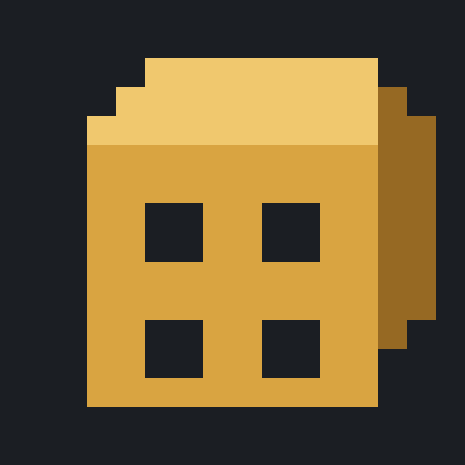
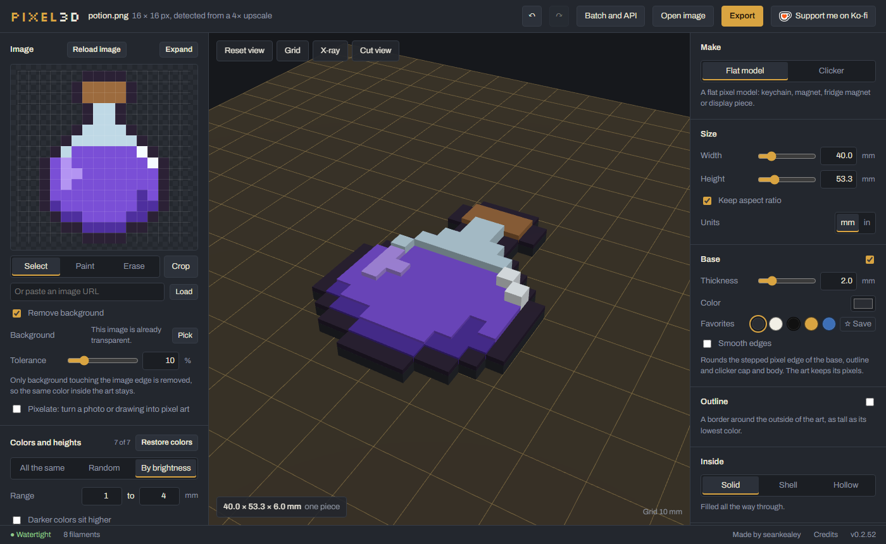

<p align="center"></p>

# pixel3d

[](https://ko-fi.com/seankealey)

**Use it in your browser: https://skealeye.github.io/pixel3d/**



Turns pixel art into 3D-print models (3MF or STL, plus OBJ and FBX for other 3D tools): one raised block per pixel, optional base, keychain loop or hole, and magnet pockets. Colors become separate parts so a multi-color printer can print them.

## Mechanical clickers

Switch Make to **Clicker** and your art becomes a working fidget clicker: a key cap that clicks on a mechanical keyboard switch (MX-compatible). It prints as two parts, the cap with your pixel art on top and a body that holds the switch. Pick the body shape (outline, circle or square), border, cap height and fit gap, use 1 to 3 switches, and preview it apart as printed or assembled, with a Press button to push the cap down. You supply the switch (an MX-style one); the sockets are carved for you.

## Run the app on this PC

`npm run dev:web -- --port 5180` and open http://localhost:5180/. Or make a desktop shortcut that does both with one
double-click (no console window; the server keeps running in the background until you sign out):

```
powershell -ExecutionPolicy Bypass -File scripts/make-shortcut.ps1
```

## Commands

Build the CLI once with `npm install && npm run build:cli` (output: `packages/cli/dist/px3d.mjs`).

```
px3d convert <files|globs|dirs...> --out|-o <dir> [--preset p.json] [--format stl|3mf|obj|fbx] [--set key=value ...]
px3d serve [--port 7300] [--host 127.0.0.1] [--debug]   # HTTP API for scripts
px3d mcp                                                 # MCP server for Claude, over stdio
px3d --version
px3d --help
```

## Use with Claude (MCP)

`px3d mcp` gives Claude four tools: `convert_image`, `convert_folder`, `inspect_image` (palette for writing color rules) and `list_presets`. Relative paths resolve against the folder Claude starts the server in.

Claude Code:

```
claude mcp add px3d -- px3d mcp
```

Claude Desktop (`px3d` may not be on PATH, so call the built bundle with node). Add this to `claude_desktop_config.json`, using the absolute path to your checkout:

```json
{
  "mcpServers": {
    "px3d": {
      "command": "node",
      "args": ["C:/path/to/pixel3d/packages/cli/dist/px3d.mjs", "mcp"]
    }
  }
}
```

## Support

pixel3d is free. If it makes your day a little better, you can
[buy me a coffee on Ko-fi](https://ko-fi.com/seankealey). ♥

## License

pixel3d is © 2026 seankealey and licensed under the [PolyForm Noncommercial License 1.0.0](LICENSE).

- Free for any noncommercial use: personal projects, hobby printing, study, schools, charities.
- Selling the app or its code, or using them in a commercial product, isn't allowed.
- The models you make with pixel3d are yours.

The open-source libraries pixel3d includes keep their own licenses; see [THIRD_PARTY_LICENSES.txt](THIRD_PARTY_LICENSES.txt) (also linked as Credits in the app footer).
